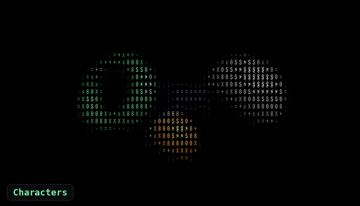

# ASCIIt

[English](README.md) · **Bahasa Indonesia**

[](LICENSE)


Editor ASCII real-time yang jalan **100% di browser, di GPU kamu**.
Tanpa server, tanpa akun, tanpa kredit, tanpa tracking.

<p align="center">
  
</p>

## Empat mode render

| Characters | Braille |
|---|---|
|  |  |
| Ramp glyph dengan warna asli sumber, 6 preset + charset manual, edge boost | 2×4 titik per cell, dibaca dari 8 texel (bukan ramp tiruan), Unicode braille asli |
| **Dither** | **3D Hex** |
|  |  |
| bayer8 / halftone / lines dengan 6 palet (mono, grey4, gameboy, pico8, cga, cyberpunk) | Prisma heksagon 3 muka (shading 1.35 / 1.0 / 0.55), geometri instanced |

## Hasilnya teks sungguhan

Ekspor TXT memilih setiap karakter dengan rumus yang sama persis dengan shader, jadi yang kamu
lihat itulah yang kamu dapat. Ini gambar contoh yang diekspor di mode Braille, 90 kolom:

```
⠀⠀⠀⠀⠀⠀⢀⣤⣶⣾⣿⣿⣷⣶⣄⡀⠀⠀⠀⠀⠀⠀⠀⠀⠀⠀⠀⠀⠀⠀⠀⠀⠀⠀⠀⠀⠀⢀⣀⣀⣤⣀⣀⡀⠀⠀⠀⠀⠀⠀⠀
⠀⠀⠀⠀⣠⣾⠿⠛⠉⠉⠛⢿⣿⣿⣿⣿⣆⠀⠀⠀⠀⠀⠀⠀⠀⠀⠀⠀⠀⠀⠀⠀⠀⠀⣀⣴⣾⣿⣿⣿⣿⣿⣿⣿⣷⣦⣄⠀⠀⠀⠀
⠀⠀⢀⣴⣿⠃⠀⠀⠀⠀⠀⠀⢹⣿⣿⣿⣿⣧⠀⠀⠀⠀⠀⠀⠀⠀⠀⠀⠀⠀⠀⠀⢀⣼⣿⣿⣿⣿⣿⣿⣿⣿⣿⣿⣿⣿⣿⣷⡄⠀⠀
⠀⠀⣾⣿⣿⠀⠀⠀⠀⠀⠀⠀⠀⣿⣿⣿⣿⣿⡆⠀⠀⠀⠀⠀⠀⠀⠀⠀⠀⠀⠀⠀⣿⣿⣿⣿⣿⣿⣿⣿⣿⣿⣿⣿⣿⣿⣿⣿⣿⣆⠀
⠀⣼⣿⣿⣿⡄⠀⠀⠀⠀⠀⠀⠀⣿⣿⣿⣿⣿⣷⠀⠀⠀⠀⠀⠀⠀⠀⠀⠀⠀⠀⠀⠙⠻⣿⣿⣿⣿⣿⣿⣿⣿⣿⣿⣿⣿⣿⣿⣿⣿⡄
⢰⣿⣿⣿⣿⡇⠀⠀⠀⠀⠀⠀⢀⣿⣿⣿⣿⣿⣿⠀⠀⠀⠀⠉⠁⠀⠀⠀⠀⠀⠀⠀⠀⠀⠈⢻⣿⣿⣿⣿⣿⣿⣿⣿⣿⣿⣿⣿⣿⣿⣧
⣸⣿⣿⣿⣿⡇⠀⠀⠀⠀⠀⠀⣼⣿⣿⣿⣿⣿⡟⠀⠀⠀⠀⠀⠀⠀⠀⠀⠀⠀⠀⠀⠀⠀⠀⠀⠙⢿⣿⣿⣿⣿⣿⣿⣿⣿⣿⣿⣿⣿⣿
⣿⣿⣿⣿⣿⣷⠀⠀⠀⠀⠀⣼⣿⣿⣿⣿⣿⣿⠃⠀⠀⠀⠀⠀⠀⠀⠀⠀⠀⠀⠀⠀⠀⠀⠀⠀⠀⠀⠙⢿⣿⣿⣿⣿⣿⣿⣿⣿⣿⣿⣿
⢸⣿⣿⣿⣿⣿⡀⠀⢀⣠⣾⣿⣿⣿⣿⣿⣿⡟⠀⠀⠀⠀⠀⠀⠀⠀⠀⠀⠀⠀⠀⠀⠀⠀⠀⠀⠀⠀⠀⠀⠙⠿⣿⣿⣿⣿⣿⣿⣿⣿⡇
⠈⢿⣿⣿⣿⣿⣿⣿⣿⣿⣿⣿⣿⣿⣿⡿⠋⠀⠀⣠⣴⣶⣿⣿⣷⣦⣄⠀⠀⠀⠀⠀⠀⠀⠀⠀⠀⠀⠀⠀⠀⠀⠈⠙⠿⣿⣿⣿⣿⡟⠀
⠀⠀⠻⢿⣿⣿⣿⣿⣿⣿⣿⠿⠿⠛⠉⠀⠀⢀⣼⣿⣿⣿⣿⣿⣿⣿⣿⣷⡀⠀⠀⠀⠀⠀⠀⠀⠀⠀⠀⠀⠀⠀⠀⠀⠀⠀⠉⠉⠉⠀⠀
⠀⠀⠀⠀⠀⠉⠉⠉⠁⠀⠀⠀⠀⠀⠀⠀⠀⣾⣿⣿⣿⣿⣿⣿⣿⣿⣿⣿⣷⡀⠀⠀⠀⠀⠀⠀⠀⠀⠀⠀⠀⠀⠀⠀⠀⠀⠀⠀⠀⠀⠀
⠀⠀⠀⠀⠀⠀⠀⠀⠀⠀⠀⠀⠀⠀⠀⠀⠀⠉⠻⣿⣿⣿⣿⣿⣿⣿⣿⣿⣿⡇⠀⠀⠀⠀⠀⠀⠀⠀⠀⠀⠀⠀⠀⠀⠀⠀⠀⠀⠀⠀⠀
⠀⠀⠀⠀⠀⠀⠀⠀⠀⠀⠀⠀⠀⠀⠀⠀⠀⠀⠀⠹⣿⣿⣿⣿⣿⣿⣿⣿⣿⡇⠀⠀⠀⠀⠀⠀⠀⠀⠀⠀⠀⠀⠀⠀⠀⠀⠀⠀⠀⠀⠀
⠀⠀⠀⠀⠀⠀⠀⠀⠀⠀⠀⠀⠀⠀⠀⠀⠀⠀⠀⠀⠈⠻⣿⣿⣿⣿⣿⣿⣿⠃⠀⠀⠀⠀⠀⠀⠀⠀⠀⠀⠀⠀⠀⠀⠀⠀⠀⠀⠀⠀⠀
⠀⠀⠀⠀⠀⠀⠀⠀⠀⠀⠀⠀⠀⠀⠀⠀⠀⠀⠀⠀⠀⠀⠀⠉⠛⠻⠿⠛⠁⠀⠀⠀⠀⠀⠀⠀⠀⠀⠀⠀⠀⠀⠀⠀⠀⠀⠀⠀⠀⠀⠀
```

## Jalankan

Butuh Python 3 saja (untuk server statis) + browser modern dengan WebGL2.

```bash
git clone https://github.com/nabotz/asciit.git
cd asciit
./run.sh            # default port 8123
# atau: python3 -m http.server 8123 --bind 127.0.0.1
```

Buka **http://localhost:8123**. Video contoh: **http://localhost:8123/?video=assets/demo.mp4**.

**Windows:** klik dua kali `run.bat` (atau `run.bat 8124` dari terminal untuk port lain).
Script ini mencari Python 3 (`py` / `python` / `python3`), membuka browser otomatis, dan
memaksa file `.js` dikirim sebagai `text/javascript` — di sebagian Windows registry
mendaftarkan `.js` sebagai `text/plain`, dan browser menolak ES module dengan tipe itu.

> Kenapa perlu server? Browser memblokir ES module + tekstur dari `file://`.
> `./run.sh` cuma `http.server` bawaan Python — tidak ada dependensi.

## Kontrol

Sumber bisa dibuka lewat tombol **Buka gambar/video**, atau di-drag & drop ke mana saja di
jendela. Di sidebar ada kolom grid, ukuran cell, contrast/brightness/invert,
edge boost, pengaturan dither, dan 4 post FX (chromatic, scanline, vignette, grain). Video
punya player bar: play/pause, timeline, ±1 frame, kecepatan, dan suara.

| Tombol | Fungsi |
|---|---|
| `1`–`4` | Ganti mode (Characters · Braille · Dither · 3D Hex) |
| `Spasi` | Play / pause |
| `←` / `→` | Frame sebelumnya / berikutnya |
| `Shift` + `←` / `→` | Mundur / maju 1 detik |
| `E` | Simpan PNG |
| `T` | Simpan TXT |

Bahasa UI: **Indonesia / English** — tombol `ID`/`EN` di kiri atas, pilihan disimpan di browser.
Bahasa awal mengikuti bahasa browser; `?lang=en` atau `?lang=id` di URL untuk memaksa sekali buka.

## Ekspor

- **PNG** — frame yang sedang tampil, resolusi = `cols × cell` (mis. 110 × 8 → 880 px).
  Untuk video: pause, lalu pilih frame lewat timeline atau `←`/`→`.
- **TXT / Salin** — teks ASCII frame yang sedang tampil (mode Characters & Braille). Buka dengan
  font monospace; braille butuh font yang punya glyph U+2800–U+28FF.
- **Video** — direkam real-time dari canvas lewat `MediaRecorder`:
  - *1 putaran penuh*: dari 0:00 sampai akhir video, kecepatan dipaksa 1×;
  - *durasi kustom*: N detik dari 0:00 (video diulang kalau lebih pendek);
  - audio video ikut terekam kalau dicentang dan videonya bersuara;
  - ada progres + tombol Batal; posisi, kecepatan, dan status play dikembalikan setelah selesai.

## Dukungan browser

| | Chrome / Edge | Firefox | Safari |
|---|---|---|---|
| Render (WebGL2) | ✅ | ✅ | ✅ 15+ |
| ±1 frame akurat (`requestVideoFrameCallback`) | ✅ 83+ | ✅ 132+ | ✅ 15.4+ |
| Ekspor video | MP4 (versi baru) + WebM | WebM | MP4 (+ WebM di versi baru) |
| Ekspor PNG / TXT, salin ke clipboard | ✅ | ✅ | ✅ |

Dikembangkan dan diuji di Chromium. Format video dideteksi saat app berjalan lewat
`MediaRecorder.isTypeSupported()`, jadi app hanya menawarkan format yang benar-benar bisa direkam
browser-mu. Tanpa `requestVideoFrameCallback`, langkah per frame memakai perkiraan 30 fps.

## GPU

Semua kerja berat ada di GPU lewat WebGL2 (bukan canvas 2D):

```
sumber (gambar / video)
   │
   ├─ pass 1  grid      : source → tekstur cols×rows (levels/contrast/brightness/invert)
   ├─ pass 2  glyph     : cols×rows instanced quad, slot atlas dipilih di vertex shader
   │                       · characters : indeks ramp dari luma
   │                       · braille    : 8 texel (2×4) → bitmask Unicode U+2800
   │                       · dither     : fullscreen bayer8/halftone + palet
   │                       · hex        : geometri prisma heksagon (instanced)
   └─ pass 3  post FX   : chromatic · scanline · vignette · grain
```

- **1 draw call** untuk seluruh grid karakter (`drawArraysInstanced`).
- Atlas glyph dibuat sekali per charset/font-size, disimpan sebagai tekstur.
- Video diproses sebagai tekstur tiap frame (`texImage2D`) — tidak ada `getImageData`
  per frame, jadi tidak ada readback CPU yang bikin lambat.
- Satu-satunya readback: 64×64 piksel untuk auto-levels (min/max luma per frame).

Angka FPS ada di kiri bawah. Bebannya ringan untuk GPU sungguhan: demo bawaan (110 kolom)
cuma 110×38 = 4.180 instance per frame, dan 300 kolom pada sumber 16:9 (±31.000 instance)
masih nyaman. Di software renderer tanpa GPU (SwiftShader) jalannya hanya beberapa fps.
Kalau terasa berat: turunkan kolom/ukuran cell atau matikan post FX.

## Struktur

```
index.html          UI + kontrol (tanpa framework)
js/shaders.js       semua GLSL: grid, glyph, dither, hex, post
js/gl.js            helper WebGL2: program, FBO, atlas glyph, geometri hex
js/main.js          state, render loop, sumber (image/video), ekspor
js/i18n.js          teks UI dua bahasa (Indonesia / English)
assets/demo.jpg     gambar contoh
assets/demo.mp4     klip contoh 4 detik
docs/               gambar untuk README (GIF demo, galeri mode, social preview)
run.sh              server statis
run.bat             server statis untuk Windows (klik dua kali)
```

## Cara menambah

- **Charset baru**: tambahkan ke `RAMP_PRESETS` di `js/main.js` (atau ketik langsung
  di kolom Charset). Atlas dibangun ulang otomatis.
- **Palet dither baru**: tambahkan array RGB ke `PALETTES` dan `<option>` di `index.html`
  (maksimum 16 warna, seragam `uPalette[16]`).
- **Post FX baru**: salin satu blok di `FS_POST` (`js/shaders.js`) + slider baru di
  `index.html` lalu teruskan uniform-nya di `main.js`.
- **Efek shader lain** (halftone, thermal, glitch, dst): masing-masing butuh shader
  sendiri; tambahkan sebagai pass baru antara scene dan post.
- **Bahasa baru**: salin blok `en` di `js/i18n.js`, ganti kodenya (mis. `ja`), terjemahkan
  isinya, lalu tambahkan tombol `<button data-lang="ja">JA</button>` di `index.html`.

## Roadmap

- [x] Mode Characters, Braille, Dither, dan 3D Hex
- [x] Player video dengan langkah per frame
- [x] Ekspor PNG, TXT, dan video MP4/WebM
- [x] UI Indonesia / English
- [ ] Dither Floyd–Steinberg (error diffusion)
- [ ] Efek shader tambahan (halftone, glitch, thermal)
- [ ] Ekspor video per frame dengan WebCodecs (tanpa frame yang hilang)
- [ ] Ekspor teks berwarna (HTML / ANSI)
- [ ] Sidebar yang bisa diubah lebarnya dan tampilan mobile yang lebih baik

## Batasan

- **Dither Floyd–Steinberg** (error diffusion) tidak ada di sini — versi GPU ini hanya
  algoritma *ordered* (bayer/halftone/lines). Floyd butuh propagasi error berurutan,
  praktisnya di CPU/shader multi-pass.
- **Efek shader** baru 4 post FX umum (chromatic, scanline, vignette, grain).
- **Font** bergantung pada font sistem (`Courier New` → fallback monospace). Bentuk glyph
  bisa beda tipis dari browser lain.
- **Video ekspor** direkam real-time (bukan encode per frame): frame yang masuk = frame yang
  sempat dirender, jadi di GPU lambat fps hasilnya turun; tab harus tetap di depan.
  File WebM dari `MediaRecorder` tidak menyimpan durasi di header (sebagian player tidak
  bisa seek) — pilih MP4 kalau tersedia.
- **±1 frame** memakai perkiraan fps dari pemutaran (mis. 24/25/29,97/30/60). Untuk video
  VFR (fps berubah-ubah) langkahnya bisa tidak persis 1 frame.
- **`?video=URL`** mengunduh video dulu jadi blob, karena server statis Python tidak
  mendukung HTTP Range (tanpa itu video tidak bisa di-seek).
- Braille memakai 8 texel per cell sehingga grid braille 2× lebih lebar dari mode lain —
  itu memang sifat braille, bukan bug.

## Lisensi & kredit

Algoritma yang dipakai di sini (luma grid, ramp glyph, ordered dither, prisma hex,
deteksi tepi Sobel) adalah teknik publik. Kode ini ditulis sendiri, bukan salinan kode
atau aset aplikasi lain. Gambar dan klip contoh adalah render 3D orisinal yang dibuat
untuk proyek ini.

Dirilis dengan lisensi [MIT](LICENSE). Terinspirasi dari [ascii-magic.com](https://ascii-magic.com).
