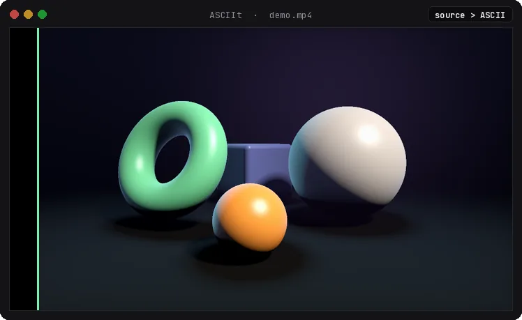
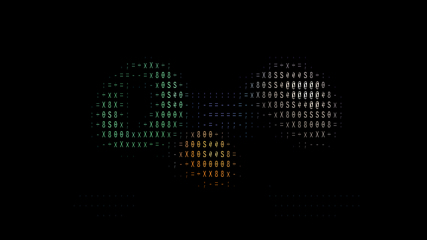
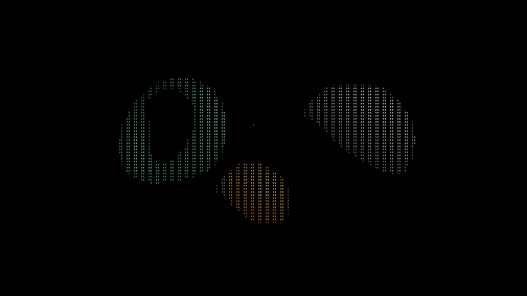
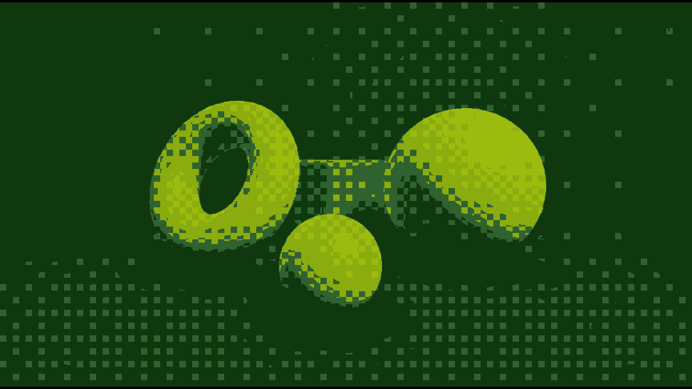
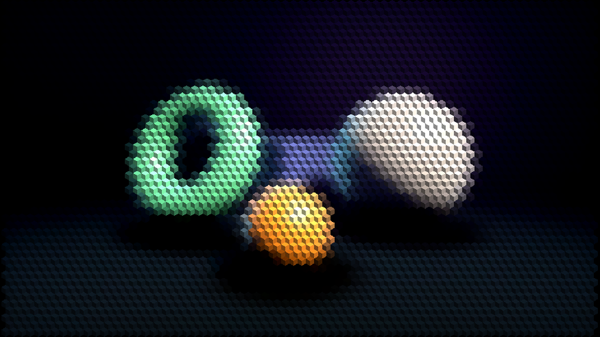
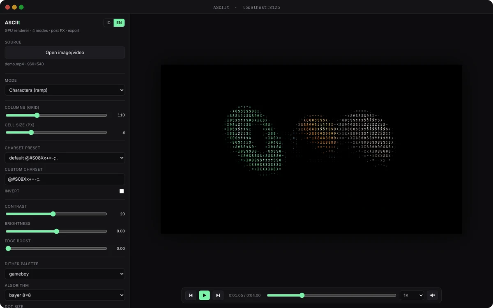

<div align="center">

<picture>
  <source media="(prefers-color-scheme: dark)" srcset="docs/logo-dark.svg">
  <source media="(prefers-color-scheme: light)" srcset="docs/logo-light.svg">
  
</picture>

### Turn any image or video into live ASCII art, right on your GPU.

<sub>No server · no account · no credits · no tracking · nothing leaves your machine</sub>

<br><br>

<a href="LICENSE"></a>


**English** &nbsp;·&nbsp; [Bahasa Indonesia](README.id.md)

[Modes](#four-ways-to-draw-a-pixel) &nbsp;·&nbsp;
[Text export](#its-actual-text-not-a-picture-of-text) &nbsp;·&nbsp;
[Player](#scrub-step-record) &nbsp;·&nbsp;
[Quick start](#run-it-locally) &nbsp;·&nbsp;
[Shortcuts](#keyboard-first) &nbsp;·&nbsp;
[How it works](#how-it-works) &nbsp;·&nbsp;
[Roadmap](#whats-next)

<br>



<br><br>

<table>
<tr>
<td width="33%" valign="top">
<br>
<b>Four render modes</b><br>
<sub>Characters, Braille, Dither and 3D Hex. Switch with <kbd>1</kbd>–<kbd>4</kbd>.</sub>
</td>
<td width="33%" valign="top">
<br>
<b>Real text out</b><br>
<sub>TXT export and copy use the same formula as the shader. What you see is what you paste.</sub>
</td>
<td width="33%" valign="top">
<br>
<b>Frame-by-frame player</b><br>
<sub>Play, scrub, step ±1 frame, change speed, toggle sound.</sub>
</td>
</tr>
<tr>
<td width="33%" valign="top">
<br>
<b>Video export</b><br>
<sub>MP4 or WebM with audio, one full loop or a custom length.</sub>
</td>
<td width="33%" valign="top">
<br>
<b>One draw call</b><br>
<sub>The whole character grid is a single instanced draw, with no per-frame CPU readback.</sub>
</td>
<td width="33%" valign="top">
<br>
<b>Zero dependencies</b><br>
<sub>No framework, no npm, no build. Python's static server is all it needs.</sub>
</td>
</tr>
</table>

</div>

<br>

<p align="center"></p>

<sub><b>01</b> &nbsp;·&nbsp; RENDER MODES</sub>

## Four ways to draw a pixel

<table>
<tr>
<td width="50%" valign="top">
<br>
<kbd>1</kbd> &nbsp;<b>Characters</b><br>
<sub>Glyph ramp in the source's own colors. 6 presets plus a custom charset, with edge boost.</sub>
</td>
<td width="50%" valign="top">
<br>
<kbd>2</kbd> &nbsp;<b>Braille</b><br>
<sub>2×4 dots per cell, read from 8 texels instead of a fake ramp. Real Unicode braille.</sub>
</td>
</tr>
<tr>
<td width="50%" valign="top">
<br>
<kbd>3</kbd> &nbsp;<b>Dither</b><br>
<sub>bayer8, halftone, lines or Floyd–Steinberg, with 6 palettes: mono, grey4, gameboy, pico8, cga, cyberpunk.</sub>
</td>
<td width="50%" valign="top">
<br>
<kbd>4</kbd> &nbsp;<b>3D Hex</b><br>
<sub>Three-faced hexagonal prisms (1.35 / 1.0 / 0.55 shading), drawn as instanced geometry.</sub>
</td>
</tr>
</table>

<sub><b>02</b> &nbsp;·&nbsp; REAL TEXT</sub>

## It's actual text, not a picture of text

The TXT export picks every character with the same formula as the shader, so the file matches
the screen. Here's the sample image exported in Braille mode at 90 columns. Select it, copy it,
paste it anywhere.

```
⠀⠀⠀⠀⠀⠀⢀⣤⣶⣾⣿⣿⣷⣶⣄⡀⠀⠀⠀⠀⠀⠀⠀⠀⠀⠀⠀⠀⠀⠀⠀⠀⠀⠀⠀⠀⠀⢀⣀⣀⣤⣀⣀⡀⠀⠀⠀⠀⠀⠀⠀
⠀⠀⠀⠀⣠⣾⠿⠛⠉⠉⠛⢿⣿⣿⣿⣿⣆⠀⠀⠀⠀⠀⠀⠀⠀⠀⠀⠀⠀⠀⠀⠀⠀⠀⣀⣴⣾⣿⣿⣿⣿⣿⣿⣿⣷⣦⣄⠀⠀⠀⠀
⠀⠀⢀⣴⣿⠃⠀⠀⠀⠀⠀⠀⢹⣿⣿⣿⣿⣧⠀⠀⠀⠀⠀⠀⠀⠀⠀⠀⠀⠀⠀⠀⢀⣼⣿⣿⣿⣿⣿⣿⣿⣿⣿⣿⣿⣿⣿⣷⡄⠀⠀
⠀⠀⣾⣿⣿⠀⠀⠀⠀⠀⠀⠀⠀⣿⣿⣿⣿⣿⡆⠀⠀⠀⠀⠀⠀⠀⠀⠀⠀⠀⠀⠀⣿⣿⣿⣿⣿⣿⣿⣿⣿⣿⣿⣿⣿⣿⣿⣿⣿⣆⠀
⠀⣼⣿⣿⣿⡄⠀⠀⠀⠀⠀⠀⠀⣿⣿⣿⣿⣿⣷⠀⠀⠀⠀⠀⠀⠀⠀⠀⠀⠀⠀⠀⠙⠻⣿⣿⣿⣿⣿⣿⣿⣿⣿⣿⣿⣿⣿⣿⣿⣿⡄
⢰⣿⣿⣿⣿⡇⠀⠀⠀⠀⠀⠀⢀⣿⣿⣿⣿⣿⣿⠀⠀⠀⠀⠉⠁⠀⠀⠀⠀⠀⠀⠀⠀⠀⠈⢻⣿⣿⣿⣿⣿⣿⣿⣿⣿⣿⣿⣿⣿⣿⣧
⣸⣿⣿⣿⣿⡇⠀⠀⠀⠀⠀⠀⣼⣿⣿⣿⣿⣿⡟⠀⠀⠀⠀⠀⠀⠀⠀⠀⠀⠀⠀⠀⠀⠀⠀⠀⠙⢿⣿⣿⣿⣿⣿⣿⣿⣿⣿⣿⣿⣿⣿
⣿⣿⣿⣿⣿⣷⠀⠀⠀⠀⠀⣼⣿⣿⣿⣿⣿⣿⠃⠀⠀⠀⠀⠀⠀⠀⠀⠀⠀⠀⠀⠀⠀⠀⠀⠀⠀⠀⠙⢿⣿⣿⣿⣿⣿⣿⣿⣿⣿⣿⣿
⢸⣿⣿⣿⣿⣿⡀⠀⢀⣠⣾⣿⣿⣿⣿⣿⣿⡟⠀⠀⠀⠀⠀⠀⠀⠀⠀⠀⠀⠀⠀⠀⠀⠀⠀⠀⠀⠀⠀⠀⠙⠿⣿⣿⣿⣿⣿⣿⣿⣿⡇
⠈⢿⣿⣿⣿⣿⣿⣿⣿⣿⣿⣿⣿⣿⣿⡿⠋⠀⠀⣠⣴⣶⣿⣿⣷⣦⣄⠀⠀⠀⠀⠀⠀⠀⠀⠀⠀⠀⠀⠀⠀⠀⠈⠙⠿⣿⣿⣿⣿⡟⠀
⠀⠀⠻⢿⣿⣿⣿⣿⣿⣿⣿⠿⠿⠛⠉⠀⠀⢀⣼⣿⣿⣿⣿⣿⣿⣿⣿⣷⡀⠀⠀⠀⠀⠀⠀⠀⠀⠀⠀⠀⠀⠀⠀⠀⠀⠀⠉⠉⠉⠀⠀
⠀⠀⠀⠀⠀⠉⠉⠉⠁⠀⠀⠀⠀⠀⠀⠀⠀⣾⣿⣿⣿⣿⣿⣿⣿⣿⣿⣿⣷⡀⠀⠀⠀⠀⠀⠀⠀⠀⠀⠀⠀⠀⠀⠀⠀⠀⠀⠀⠀⠀⠀
⠀⠀⠀⠀⠀⠀⠀⠀⠀⠀⠀⠀⠀⠀⠀⠀⠀⠉⠻⣿⣿⣿⣿⣿⣿⣿⣿⣿⣿⡇⠀⠀⠀⠀⠀⠀⠀⠀⠀⠀⠀⠀⠀⠀⠀⠀⠀⠀⠀⠀⠀
⠀⠀⠀⠀⠀⠀⠀⠀⠀⠀⠀⠀⠀⠀⠀⠀⠀⠀⠀⠹⣿⣿⣿⣿⣿⣿⣿⣿⣿⡇⠀⠀⠀⠀⠀⠀⠀⠀⠀⠀⠀⠀⠀⠀⠀⠀⠀⠀⠀⠀⠀
⠀⠀⠀⠀⠀⠀⠀⠀⠀⠀⠀⠀⠀⠀⠀⠀⠀⠀⠀⠀⠈⠻⣿⣿⣿⣿⣿⣿⣿⠃⠀⠀⠀⠀⠀⠀⠀⠀⠀⠀⠀⠀⠀⠀⠀⠀⠀⠀⠀⠀⠀
⠀⠀⠀⠀⠀⠀⠀⠀⠀⠀⠀⠀⠀⠀⠀⠀⠀⠀⠀⠀⠀⠀⠀⠉⠛⠻⠿⠛⠁⠀⠀⠀⠀⠀⠀⠀⠀⠀⠀⠀⠀⠀⠀⠀⠀⠀⠀⠀⠀⠀⠀
```

<sub><b>03</b> &nbsp;·&nbsp; PLAYER & EXPORT</sub>

## Scrub, step, record

<p align="center">
  
</p>

Load a source with **Open image/video**, or drag & drop a file anywhere on the window. The sidebar has grid columns, cell size, contrast, brightness, invert, edge boost,
dither settings and 4 post FX (chromatic, scanline, vignette, grain).

| Export | What you get |
|---|---|
| **PNG** | The frame on screen at `cols × cell` resolution (110 × 8 → 880 px). Pause a video and pick the exact frame first. |
| **TXT / Copy** | The current frame as plain text (Characters & Braille). Braille needs a font with U+2800–U+28FF. |
| **Video** | Recorded live from the canvas with `MediaRecorder`: one full loop at 1×, or N seconds from 0:00. Audio included if the video has sound. Progress bar and Cancel; position, speed and play state are restored afterwards. |

<sub><b>04</b> &nbsp;·&nbsp; QUICK START</sub>

## Run it locally

You need Python 3 (for a static file server) and a browser with WebGL2.

```bash
git clone https://github.com/nabotz/asciit.git
cd asciit
./run.sh            # serves on port 8123
```

Then open **http://localhost:8123**, or **http://localhost:8123/?video=assets/demo.mp4** for the sample clip.

> [!TIP]
> **On Windows**, double-click `run.bat` (or run `run.bat 8124` for another port). It finds
> Python 3 (`py` / `python` / `python3`), opens your browser, and forces `.js` to be served as
> `text/javascript`. Some Windows registries map `.js` to `text/plain`, which browsers refuse
> to load as an ES module.

> [!NOTE]
> **Why a server at all?** Browsers block ES modules and textures loaded from `file://`.
> `run.sh` is just Python's built-in `http.server`, so there's still nothing to install.

<sub><b>05</b> &nbsp;·&nbsp; SHORTCUTS</sub>

## Keyboard first

| Keys | Action |
|---|---|
| <kbd>1</kbd> <kbd>2</kbd> <kbd>3</kbd> <kbd>4</kbd> | Characters · Braille · Dither · 3D Hex |
| <kbd>Space</kbd> | Play / pause |
| <kbd>←</kbd> <kbd>→</kbd> | Previous / next frame |
| <kbd>Shift</kbd> + <kbd>←</kbd> <kbd>→</kbd> | Back / forward 1 second |
| <kbd>E</kbd> | Save PNG |
| <kbd>T</kbd> | Save TXT |

The UI speaks **English and Indonesian**. Use the `EN` / `ID` buttons in the top-left corner; your
choice is remembered. The first visit follows your browser language, and `?lang=en` or `?lang=id`
forces one for a single visit.

<sub><b>06</b> &nbsp;·&nbsp; BROWSER SUPPORT</sub>

## Where it runs

| | Chrome / Edge | Firefox | Safari |
|---|:---:|:---:|:---:|
| Rendering (WebGL2) | ✅ | ✅ | ✅&nbsp;15+ |
| Accurate ±1 frame (`requestVideoFrameCallback`) | ✅&nbsp;83+ | ✅&nbsp;132+ | ✅&nbsp;15.4+ |
| Video export | MP4 (recent) + WebM | WebM | MP4 (+ WebM in recent) |
| PNG / TXT export, copy to clipboard | ✅ | ✅ | ✅ |

Developed and tested in Chromium. Video formats are detected at runtime with
`MediaRecorder.isTypeSupported()`, so the app only offers what your browser can actually record.
Without `requestVideoFrameCallback`, frame stepping falls back to a 30 fps estimate.

<sub><b>07</b> &nbsp;·&nbsp; UNDER THE HOOD</sub>

## How it works

<details>
<summary><b>The GPU pipeline</b></summary>

<br>

All the heavy lifting happens on the GPU through WebGL2, not canvas 2D:

```
source (image / video)
   │
   ├─ pass 1  grid      : source → cols×rows texture (levels/contrast/brightness/invert)
   ├─ pass 2  glyph     : cols×rows instanced quads, atlas slot picked in the vertex shader
   │                       · characters : ramp index from luma
   │                       · braille    : 8 texels (2×4) → Unicode U+2800 bitmask
   │                       · dither     : fullscreen bayer8/halftone/lines + palette
   │                                      (Floyd–Steinberg: small grid → CPU error diffusion → blocks)
   │                       · hex        : hexagonal prism geometry (instanced)
   └─ pass 3  post FX   : chromatic · scanline · vignette · grain
```

- **1 draw call** for the whole character grid (`drawArraysInstanced`).
- The glyph atlas is built once per charset and font size, and kept as a texture.
- Video frames are uploaded as textures (`texImage2D`). No per-frame `getImageData`, so no slow CPU readback.
- The only readbacks are 64×64 pixels for auto-levels (min/max luma per frame) and, with Floyd–Steinberg, the small dither grid (output size ÷ dot size).

The load is light for a real GPU: the default demo (110 columns) is 110×38 = 4,180 instances per
frame, and 300 columns on a 16:9 source (~31,000 instances) is still comfortable. On a software
renderer without a GPU (SwiftShader) it only manages a few fps. If it feels heavy, lower the
columns or cell size, or turn off post FX. The FPS counter sits in the bottom-left corner.

</details>

<details>
<summary><b>Project structure</b></summary>

<br>

```
index.html          UI + controls (no framework)
js/shaders.js       all GLSL: grid, glyph, dither, hex, post
js/gl.js            WebGL2 helpers: programs, FBOs, glyph atlas, hex geometry
js/main.js          state, render loop, sources (image/video), export
js/dither.js        Floyd–Steinberg error diffusion (CPU)
js/i18n.js          two-language UI strings (English / Indonesian)
assets/demo.jpg     sample image
assets/demo.mp4     4-second sample clip
docs/               README media (logo, hero, icons, gallery, social preview)
run.sh              static server
run.bat             static server for Windows (double-click)
```

</details>

<details>
<summary><b>Extending it</b></summary>

<br>

- **New charset:** add it to `RAMP_PRESETS` in `js/main.js`, or type it straight into the Charset field. The atlas rebuilds automatically.
- **New dither palette:** add an RGB array to `PALETTES` and an `<option>` in `index.html` (16 colors max, uniform `uPalette[16]`).
- **New post FX:** copy a block in `FS_POST` (`js/shaders.js`), add a slider in `index.html`, then pass its uniform in `main.js`.
- **Other shader effects** (halftone, thermal, glitch, …): each needs its own shader; add it as a new pass between scene and post.
- **New UI language:** copy the `en` block in `js/i18n.js`, change its code (e.g. `ja`), translate it, then add `<button data-lang="ja">JA</button>` in `index.html`.

</details>

<details>
<summary><b>Known limitations</b></summary>

<br>

- **Floyd–Steinberg runs on the CPU.** Error diffusion is sequential, so it can't run in a WebGL2 fragment shader. The GPU prepares a small grid (output size ÷ dot size), JavaScript diffuses the error, and the GPU draws the result as blocks.
- **Floyd–Steinberg shimmers on video.** A small change in one pixel moves the error along to the pixels after it, so the pattern shifts between frames even where the picture stands still. On the sample clip, 10–25% of the dots whose input didn't change still flipped each frame; bayer, halftone and lines stay put. Use those for video.
- **Shader effects:** only 4 common post FX so far (chromatic, scanline, vignette, grain).
- **Fonts** come from the system (`Courier New`, then any monospace), so glyph shapes can differ slightly between browsers.
- **Video export is real-time**, not frame-by-frame encoding: only frames that get rendered end up in the file, so a slow GPU lowers the frame rate, and the tab must stay in front. WebM files from `MediaRecorder` have no duration in the header (some players can't seek them), so pick MP4 when it's offered.
- **±1 frame** uses a frame-rate estimate taken during playback (24/25/29.97/30/60…). On variable-frame-rate videos a step may not be exactly one frame.
- **`?video=URL`** downloads the video into a blob first, because Python's static server doesn't support HTTP Range requests (without them the video can't be seeked).
- Braille reads 8 texels per cell, so its grid is 2× wider than the other modes. That's how braille works, not a bug.

</details>

<sub><b>08</b> &nbsp;·&nbsp; ROADMAP</sub>

## What's next

- [x] Characters, Braille, Dither and 3D Hex modes
- [x] Video player with frame stepping
- [x] PNG, TXT and MP4/WebM export
- [x] English / Indonesian UI
- [x] Floyd–Steinberg (error-diffusion) dithering
- [ ] More shader effects (halftone, glitch, thermal)
- [ ] Frame-accurate video export with WebCodecs (no dropped frames)
- [ ] Colored HTML / ANSI text export
- [ ] Resizable sidebar and a better mobile layout

<br>

<p align="center"></p>

<div align="center">

<sub>The algorithms here (luma grid, glyph ramp, ordered dither, hex prisms, Sobel edges) are public techniques.<br>
The code was written for this project, and the sample image and clip are original 3D renders.<br>
The logo uses a subset of <a href="https://github.com/JetBrains/JetBrainsMono">JetBrains Mono</a> (<a href="docs/OFL-JetBrainsMono.txt">OFL 1.1</a>).</sub>

<sub>Released under the <a href="LICENSE">MIT</a> license &nbsp;·&nbsp; Inspired by <a href="https://ascii-magic.com">ascii-magic.com</a> &nbsp;·&nbsp; <a href="#top">Back to top ↑</a></sub>

</div>
